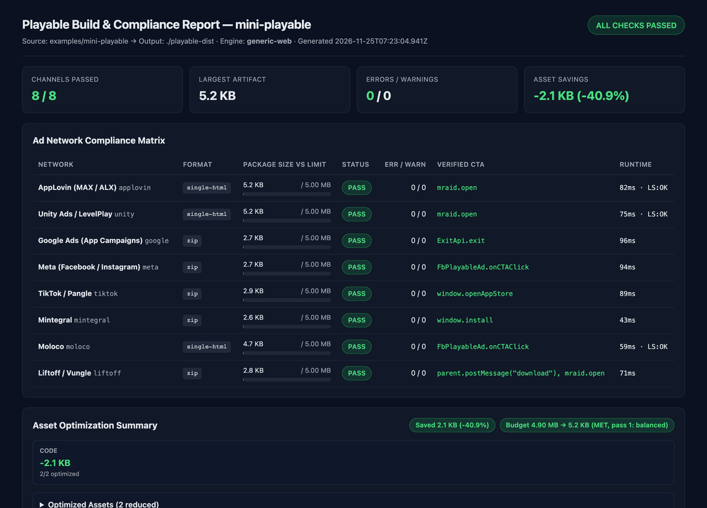
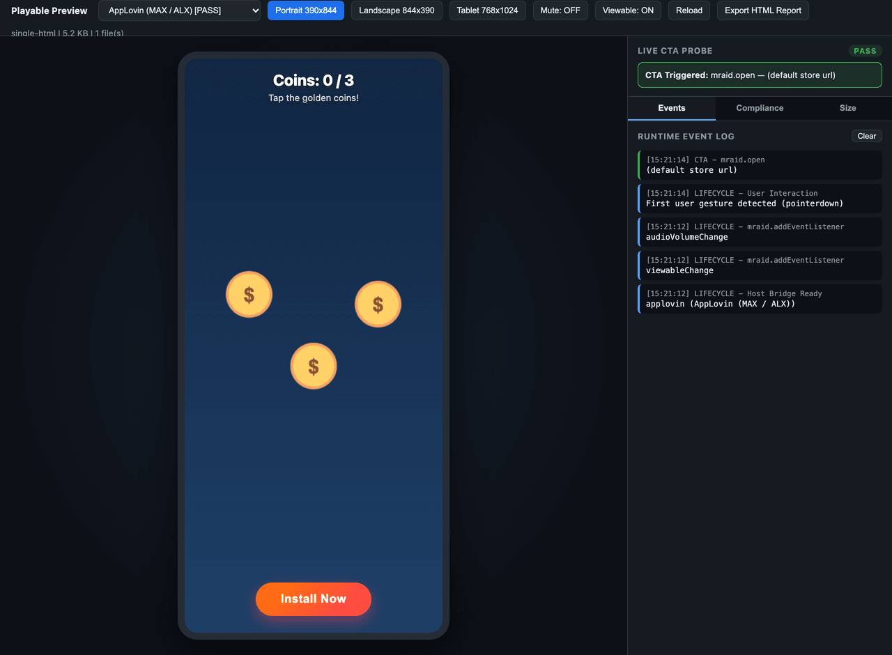

# cocos-pnp

[English](./README.md)

[](https://www.npmjs.com/package/@ppgee/playable-cli)
[](https://github.com/ppgee/cocos-pnp/actions/workflows/ci-v2.yml)
[](https://nodejs.org/)
[](./package.json)

**海外试玩广告（Playable Ads）的打包、压包、本地预览和上线前验包工具。**

做过试玩广告的都懂：同一套玩法，投 AppLovin、Unity、Google、Meta、TikTok、Mintegral、Moloco、Liftoff 8 个平台，每个平台要的格式、SDK 接口、目录命名、体积限制都不一样；打完传到广告后台，还经常碰到莫名其妙的黑屏、CSP 拦 `blob:`、Android Spine/WASM 报错或者超 5MB 被打回。

`cocos-pnp` 以前只做 Cocos Creator 的编辑器插件，从 **v2.0** 开始改成**通用命令行工具（也继续保留 Cocos 2.x/3.x 插件包）**：无论你用 Cocos Creator、Vite / PixiJS / Three.js / PlayCanvas / Godot / Unity WebGL 还是纯 H5，游戏代码只写一份，一条命令把 8 个平台的投放包全打出来；超 5MB 自动帮你本地压缩；顺手用你电脑里的 Chrome 跑一遍，看横竖屏有没有黑屏、有没有非法外链、点下载按钮有没有正确触发对应平台的跳转。

---

## 长什么样

**1. 一键打 8 渠道 + 自动验包生成的报告（点开浏览器就能直接发给投放/测试看）：**



**2. 本地预览调试台（切渠道、切横竖屏/平板、模拟静音/切后台、手机扫码真机试玩）：**



---

## 怎么上手？按你的项目选一条就行

只需要本机有 **Node.js >= 20**（不用克隆仓库，直接 `npx` 就能跑；验包时会自动找你电脑上装好的 Chrome/Edge，不需要额外下浏览器）。

### 场景 1：我是 Cocos Creator 老用户（2.x / 3.x）

你有两种用法，**推荐直接用命令行**（尤其是 Cocos 3.8+，v2 已经彻底修掉了 Facebook/Google 的 `blob:` 黑屏、Android Spine/Bullet WASM 报错和勾选 MD5 缓存打不开的问题）：

- **方式 A（推荐，直接对构建产物打包）**：先在 Cocos Creator 里正常构建出 `web-mobile`，然后在项目根目录执行：
  ```bash
  npx @ppgee/playable-cli build ./build/web-mobile -o ./playable-dist --channel all --target-size auto --check --report ./playable-dist/report.html
  ```
  你项目里原来给 v1 写的 `.adapterrc` 会自动读取，不用重新配。
- **方式 B（继续在 Cocos 编辑器里点按钮）**：去 [GitHub Releases](https://github.com/ppgee/cocos-pnp/releases) 下载 `playable-3x.zip` 或 `playable-2x.zip` 照旧安装。
  > 3.x 插件还支持在项目根目录的 `.adapterrc` 里加上 `"useV2Cli": true`，这样在 Cocos 编辑器里点构建后会自动调 v2 命令行打包并生成验包报告。

### 场景 2：我用 Vite / PixiJS / Three.js / PlayCanvas / Godot / Unity WebGL 或纯 H5

照常导出你的网页构建目录（比如 `./dist`），然后跑：

```bash
npx @ppgee/playable-cli build ./dist -o ./playable-dist \
  --channel all --target-size auto --encoding auto --check --report ./playable-dist/report.html
```

打包完成后会按渠道输出到 `./playable-dist/`（AppLovin/Unity/Moloco 是单 HTML，Google/Meta/TikTok/Mintegral/Liftoff 是符合各平台目录要求的 ZIP），同时生成一份离线 `report.html`。

### 场景 3：刚起步，想先跑个现成例子

直接用脚手架生成一个能跑、能打、能过审的起始工程（支持 `canvas` / `pixijs` / `threejs`）：

```bash
npx @ppgee/playable-cli create ./my-playable --template canvas
cd my-playable
npx @ppgee/playable-cli build --report ./playable-dist/report.html
```

> 如果你在国内用了 npm 镜像源且刚发版还没同步，可以在 `npx` 后面补上 `--registry=https://registry.npmjs.org`。

---

## 日常最常用的 5 个命令

### 1. 打包并自动压到 5MB / 2MB 以内

```bash
npx @ppgee/playable-cli build ./dist -o ./playable-dist \
  --channel applovin,unity,google,meta \
  --target-size auto \
  --encoding auto \
  --check \
  --report ./playable-dist/report.html
```

说明：
- `--target-size auto`：如果包体超过渠道限制（比如 5MB 或 Meta 单页 2MB），会自动从原图/原音视频重新压缩（图片走 `sharp`，音视频调用本机 `ffmpeg` 并把 MP4 转成 iOS 兼容的 faststart，字体只保留页面用到的字形，SVG 走 `svgo`，JS 走 `esbuild` 去死代码），分档压到刚好塞得下为止。
- `--encoding auto`：单 HTML 内联资源时自动启用 Base122 编码，比传统 Base64 无损再省约 14% 体积。
- `--check`：打完顺手做静态规则检查 + 本机 Chrome 无头真跑检查；CI 环境没有 Chrome 时加 `--static-only`。

### 2. 本地预览 + 手机局域网扫码真机测试

```bash
npx @ppgee/playable-cli preview ./playable-dist/AppLovin.html --channel applovin --lan
```

打开浏览器可以切换 8 个平台环境、竖屏/横屏/平板尺寸、静音和切后台，点击游戏里的下载按钮右侧会实时显示触发了哪个跳转 API。加上 `--lan` 后，终端和页面右上角 `Phone QR` 都会生成二维码，**手机连同一 Wi-Fi 扫一下就能全屏真机测方向切换、声音和下载按钮**（不会再报 `mraid is not defined`）。

### 3. 一份代码批量出多语言 / 多文案 A/B 变体

给买量测不同语言、不同难度或不同 CTA 文案时，不用改代码打 N 次，在 `playable.config.json` 里配好 `variants`（或通过 `--variants variants.json` 传入）：

```json
{
  "inputPath": "./dist",
  "outputDir": "./playable-dist",
  "variants": [
    { "id": "en_easy", "config": { "lang": "en", "ctaText": "Play Now" } },
    { "id": "ja_hard", "config": { "lang": "ja", "ctaText": "今すぐプレイ" } }
  ]
}
```

打包时工具会把对应参数注入到 `window.__PLAYABLE_CONFIG__`，按 `playable-dist/en_easy/`、`playable-dist/ja_hard/` 分目录输出，并在 `report.html` 里合并成一张汇总表。

### 4. 只压缩素材，不打包

```bash
npx @ppgee/playable-cli optimize ./dist -o ./dist-small --target-size 4MB
```

加 `--dry-run` 可以先看每个图片/音视频/字体能省多少，不写文件。

### 5. 单独验别人打好的包（`.html` / `.zip` / 目录都行）

```bash
npx @ppgee/playable-cli check ./some-ad/Google.zip --channel google
```

---

## 游戏代码里怎么接下载按钮和生命周期

不用在业务代码里写 `if (channel === 'Google') ... else if (channel === 'Mintegral') ...`。打包时会自动注入一个极小的 `window.playable` 对象，业务里统一这么写就行（完整例子见 [examples/mini-playable/game.js](./examples/mini-playable/game.js)）：

```js
window.playable.init({
  onStart: () => {
    startGame();
    window.playable.ready();
  },
  onPause: () => pauseAudioAndLoop(),
  onResume: () => resumeAudioAndLoop(),
  onResize: ({ width, height }) => resizeCanvas(width, height)
});

// 玩家试玩结束、弹结算页时调用（Mintegral 和 Liftoff 要求必须调）
window.playable.gameEnd();

// 下载按钮点击时调用（建议在按钮 HTML 上加 data-playable-cta，验包时会自动模拟点击测通不通）
ctaButton.addEventListener('click', () => {
  window.playable.cta();
});
```

不同渠道的产物彼此隔离：打给 Google、Meta、TikTok、Mintegral、Moloco 的包里不会混进 `mraid` 代码，避免过审被误杀。

---

## 支持的 8 个广告平台（按 2026 年实测规则）

AppLovin、Google Ads（App Campaigns）、Mintegral（Playturbo）、Liftoff Accelerate 四个公开官方验包器均已上传实测通过（0 报错）：

| 平台 | 渠道名 | 输出格式 | 体积上限 | CTA 接口 | 常见踩坑（工具已自动处理） |
| :--- | :--- | :--- | :--- | :--- | :--- |
| **AppLovin** | `applovin` | 单 HTML | <= 5 MB | `mraid.open()` | 禁止外链，必须横竖屏都能显示 |
| **Unity / LevelPlay** | `unity` | 单 HTML | <= 5 MB | `mraid.open()` | 旧 ironSource DAPI 已下线，统一走 MRAID 3.0 + `viewableChange` |
| **Google Ads** | `google` | ZIP | <= 5 MB | `ExitApi.exit()` | `ad.orientation` 和 `ad.size` 不能同时写；不支持的 `.ttf/.wav/.wasm` 会自动内联 |
| **Meta (Facebook)** | `meta` / `facebook` | ZIP | ZIP <= 5 MB 且 `index.html` <= 2 MB | `FbPlayableAd.onCTAClick()` | 最多 100 个文件；`onCTAClick()` 不能传参；超过限制会自动拆外部 JS |
| **TikTok / Pangle** | `tiktok` / `pangle` | ZIP | <= 5 MB | `window.openAppStore()` | 根目录必须有 `index.html` + `config.json` 并引入 `playable-sdk.js` |
| **Mintegral** | `mintegral` / `mtg` | ZIP | <= 5 MB | `window.install()` | 必须 `<名>.zip -> <名>/<名>.html` 且名字只能含字母数字下划线；必调 `gameReady`/`gameEnd` |
| **Moloco** | `moloco` | 单 HTML | <= 5 MB | `FbPlayableAd.onCTAClick()` | 不收 ZIP，不能含 `mraid`，横竖屏双适配 |
| **Liftoff / Vungle** | `liftoff` / `vungle` | ZIP | <= 5 MB | `mraid.open()` + `postMessage('download')` | 路径必须全小写 ASCII，禁止 `<iframe>`，结束需发 `complete` |

更细的规则对照可以看 [docs/channel-specs-2026.md](./docs/channel-specs-2026.md)，v1 迁移说明见 [docs/v2-migration.md](./docs/v2-migration.md)。

---

## 写给用 AI 编程工具的用户（可选）

> 不用 AI 写代码的话直接跳过这节，前面所有命令行功能完全不依赖 AI。

如果你平时用 Claude Code、Cursor、Codex 或 Antigravity 写试玩广告，可以把本项目作为 MCP 工具接进去，让 AI 写完代码后自己打包、查错、修到全部过检：

```json
{
  "mcpServers": {
    "cocos-pnp-playable": {
      "command": "npx",
      "args": ["-y", "@ppgee/playable-cli", "mcp"]
    }
  }
}
```

仓库里也顺手带了一份通用的提示词模板：[skills/playable-ads-workflow/SKILL.md](./skills/playable-ads-workflow/SKILL.md)。

---

## 本地开发与包结构

如果你要改源码或提 PR：

```bash
pnpm install
pnpm run test:v2      # 构建 4 个 v2 包并跑全部自动化测试
pnpm run pack:check   # 检查 npm 包导出与打包产物
```

- `packages/playable-cli`（`@ppgee/playable-cli`）：命令行、预览台、HTML 报告、脚手架、MCP
- `packages/playable-core`（`@ppgee/playable-core`）：多渠道打包、各引擎适配、资源压缩与 Base122
- `packages/playable-validator`（`@ppgee/playable-validator`）：8 渠道规则检查、体积拆解、Chrome 真跑验包
- `packages/playable-sdk`（`@ppgee/playable-sdk`）：各渠道隔离的 `window.playable` 桥接脚本
- `packages/playable-adapter-core` & `packages/playable-ads-adapter`：Cocos Creator 2.x/3.x 编辑器插件

### [Contributors](https://github.com/ppgee/cocos-pnp/graphs/contributors)

<a href="https://github.com/ppgee/cocos-pnp/graphs/contributors">
  
</a>
