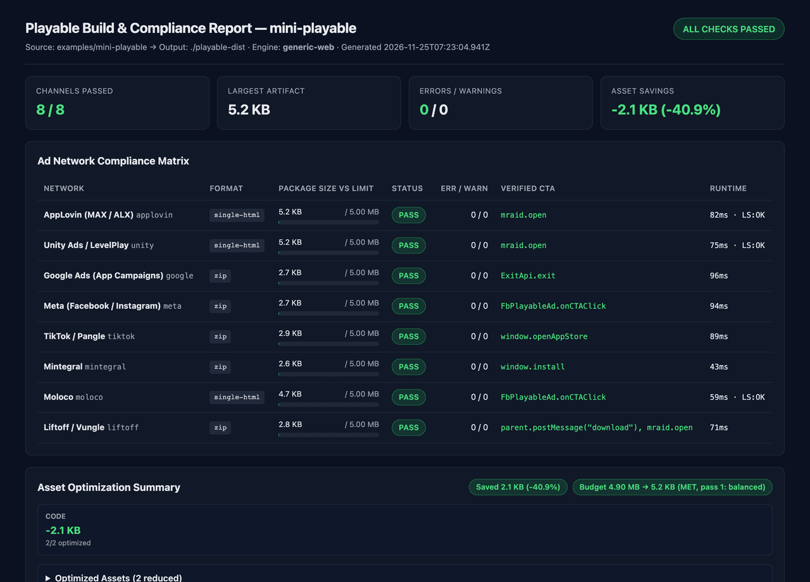
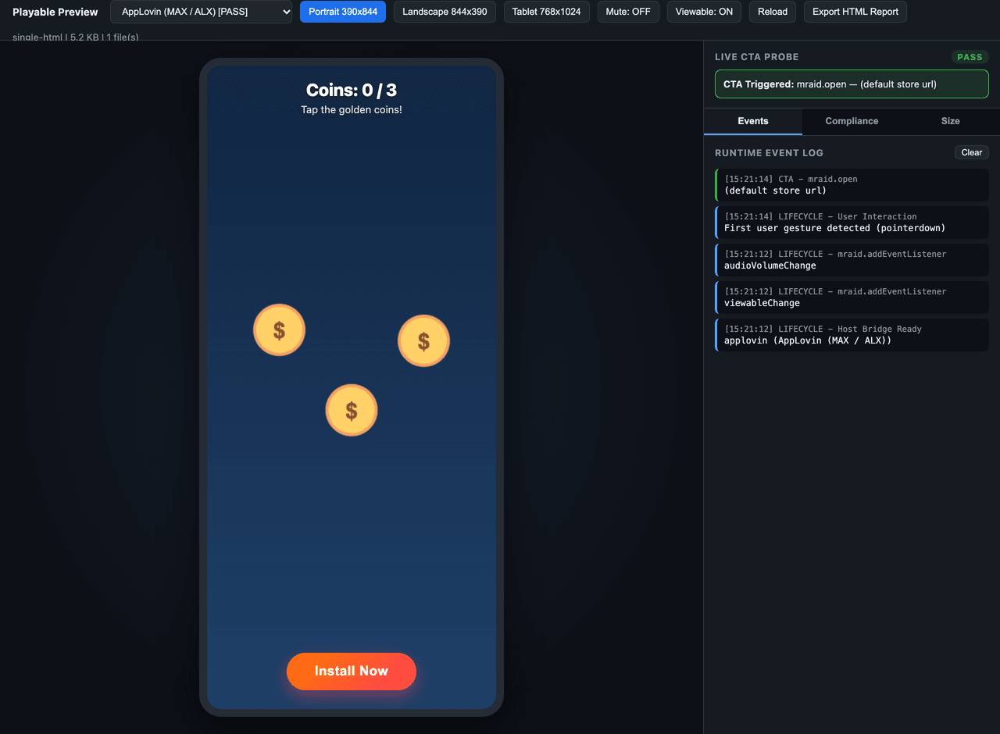

# cocos-pnp

[中文文档](./README-CN.md)

[](https://www.npmjs.com/package/@ppgee/playable-cli)
[](https://github.com/ppgee/cocos-pnp/actions/workflows/ci-v2.yml)
[](https://nodejs.org/)
[](./package.json)

**Package, shrink, preview, and test HTML5 Playable Ads for 8 major ad networks in one command.**

If you have ever shipped Playable Ads to AppLovin, Unity, Google, Meta, TikTok, Mintegral, Moloco, and Liftoff, you know the drill: every network wants a different file structure, different CTA hook, different size limit, and uploading a build often ends in a mysterious black screen, a CSP `blob:` error, an Android Spine/WASM crash, or a 5 MB rejection.

`cocos-pnp` started as a Cocos Creator plugin. Starting with **v2.0**, it is a standalone CLI (while still shipping the legacy Cocos 2.x/3.x editor plugins): build your game once with Cocos Creator, Vite, PixiJS, Three.js, PlayCanvas, Godot 4, Unity WebGL, or plain HTML5, run one command to export all 8 networks, automatically compress assets when you're over 5 MB / 2 MB, and verify everything in your local Chrome before uploading.

---

## What It Looks Like

**1. 8-network build & verification report (single offline HTML file you can send straight to QA / UA):**



**2. Local preview workbench (switch ad networks, portrait/landscape/tablet, mute/background simulation, or scan a QR code on your phone):**



---

## Pick Your Setup

Requires **Node.js >= 20**. No need to clone this repo—`npx` works out of the box. Runtime checks automatically use your installed Chrome/Chromium/Edge (no giant browser download).

### Option 1: Existing Cocos Creator Users (2.x / 3.x)

- **Recommended (especially for Cocos 3.8+)**: Build `web-mobile` in Cocos Creator as usual, then run this in your project root:
  ```bash
  npx @ppgee/playable-cli build ./build/web-mobile -o ./playable-dist --channel all --target-size auto --check --report ./playable-dist/report.html
  ```
  It reads your existing v1 `.adapterrc` automatically and fixes the common Cocos 3.8.x pain points (Facebook/Google CSP `blob:` black screens, Android Spine/Bullet WASM errors, and MD5 cache builds).
- **Prefer clicking Build inside Cocos Creator?**: Grab `playable-3x.zip` or `playable-2x.zip` from [GitHub Releases](https://github.com/ppgee/cocos-pnp/releases).
  > On Cocos 3.x, you can also add `"useV2Cli": true` to your `.adapterrc` so the editor's Build hook automatically runs the v2 CLI after export.

### Option 2: Vite / PixiJS / Three.js / PlayCanvas / Godot / Unity WebGL / Plain HTML5

Build your web output directory (e.g. `./dist`), then run:

```bash
npx @ppgee/playable-cli build ./dist -o ./playable-dist \
  --channel all --target-size auto --encoding auto --check --report ./playable-dist/report.html
```

Outputs land in `./playable-dist/` (`AppLovin.html`, `Unity.html`, `Moloco.html`, `Google.zip`, `Meta.zip`, `TikTok.zip`, `<name>_mintegral.zip`, `Liftoff.zip`) plus an offline `report.html`.

### Option 3: Starting From Scratch

Generate a ready-to-build starter project (`canvas`, `pixijs`, or `threejs`):

```bash
npx @ppgee/playable-cli create ./my-playable --template canvas
cd my-playable
npx @ppgee/playable-cli build --report ./playable-dist/report.html
```

---

## Everyday Commands

### 1. Build, auto-shrink to fit 5 MB / 2 MB, and verify

```bash
npx @ppgee/playable-cli build ./dist -o ./playable-dist \
  --channel applovin,unity,google,meta \
  --target-size auto \
  --encoding auto \
  --check \
  --report ./playable-dist/report.html
```

- `--target-size auto`: Automatically shrinks images (`sharp`), audio/video (local `ffmpeg`, H.264 faststart for iOS WebView), fonts (glyph subsetting), SVGs (`svgo`), and JS (`esbuild`) until every output fits under its network limit.
- `--encoding auto`: Uses lossless Base122 for single-HTML bundles—about 14% smaller than Base64.
- `--check`: Runs static rules + headless Chrome checks (blank screen in portrait & landscape, uncaught errors, external requests, pre-interaction audio, and CTA trigger). Pass `--static-only` in browser-less CI.

### 2. Local preview + scan QR on a real phone

```bash
npx @ppgee/playable-cli preview ./playable-dist/AppLovin.html --channel applovin --lan
```

Test all 8 simulated ad-network environments locally without `mraid is not defined` errors. Adding `--lan` prints a QR code in your terminal (and adds a `Phone QR` button in the toolbar) so anyone on the same Wi-Fi can scan and test fullscreen on iOS/Android.

### 3. Build multi-language / A/B creative variants in one run

Add `variants` to `playable.config.json` (or pass `--variants variants.json`):

```json
{
  "inputPath": "./dist",
  "outputDir": "./playable-dist",
  "variants": [
    { "id": "en_easy", "config": { "lang": "en", "ctaText": "Play Now" } },
    { "id": "ja_hard", "config": { "lang": "ja", "ctaText": "今すぐプレイ" } }
  ]
}
```

Each variant injects its parameters into `window.__PLAYABLE_CONFIG__`, writes to `./playable-dist/<variantId>/`, and rolls up into a single matrix `report.html`.

### 4. Optimize assets only (no packaging)

```bash
npx @ppgee/playable-cli optimize ./dist -o ./dist-small --target-size 4MB
```

Add `--dry-run` to preview byte savings without writing files.

### 5. Check an existing `.html`, `.zip`, or build folder

```bash
npx @ppgee/playable-cli check ./some-ad/Google.zip --channel google
```

---

## Wiring Up the CTA Button in Game Code

You don't need per-network `if/else` branches in your game. Call the injected `window.playable` helper (full example in [examples/mini-playable/game.js](./examples/mini-playable/game.js)):

```js
window.playable.init({
  onStart: () => {
    startGame();
    window.playable.ready();
  },
  onPause: () => pauseAudioAndLoop(),
  onResume: () => resumeAudioAndLoop(),
  onResize: ({ width, height }) => resizeCanvas(width, height)
});

// Call when gameplay finishes (required by Mintegral & Liftoff)
window.playable.gameEnd();

// Call on store CTA click (add data-playable-cta to the button for automated click verification)
ctaButton.addEventListener('click', () => {
  window.playable.cta();
});
```

Each network build only receives its own bridge—no stray `mraid` references leak into Google, Meta, TikTok, Mintegral, or Moloco packages.

---

## Supported Ad Networks (2026 Specs)

Verified directly against the live official validators for AppLovin, Google Ads App Campaigns, Mintegral (Playturbo), and Liftoff Accelerate (0 errors):

| Network | CLI ID | Format | Size Limit | CTA API | Handled Automatically |
| :--- | :--- | :--- | :--- | :--- | :--- |
| **AppLovin** | `applovin` | Single HTML | <= 5 MB | `mraid.open()` | Zero external requests, portrait + landscape |
| **Unity / LevelPlay** | `unity` | Single HTML | <= 5 MB | `mraid.open()` | Migrated off sunset ironSource DAPI to MRAID 3.0 + `viewableChange` |
| **Google Ads** | `google` | ZIP | <= 5 MB | `ExitApi.exit()` | `ad.orientation` without conflicting `ad.size`; disallowed `.ttf/.wav/.wasm` auto-inlined |
| **Meta (Facebook)** | `meta` / `facebook` | ZIP | ZIP <= 5 MB & `index.html` <= 2 MB | `FbPlayableAd.onCTAClick()` | <= 100 files; zero-arg CTA; auto-splits large inline JS when needed |
| **TikTok / Pangle** | `tiktok` / `pangle` | ZIP | <= 5 MB | `window.openAppStore()` | Root `index.html` + `config.json` + `playable-sdk.js` |
| **Mintegral** | `mintegral` / `mtg` | ZIP | <= 5 MB | `window.install()` | `<name>.zip -> <name>/<name>.html` (`[a-zA-Z0-9_]` only) + `gameReady`/`gameEnd` |
| **Moloco** | `moloco` | Single HTML | <= 5 MB | `FbPlayableAd.onCTAClick()` | Single HTML only, no `mraid`, dual orientation |
| **Liftoff / Vungle** | `liftoff` / `vungle` | ZIP | <= 5 MB | `mraid.open()` + `postMessage('download')` | Lowercase ASCII paths, no `<iframe>`, `complete` signal |

Detailed spec notes: [docs/channel-specs-2026.md](./docs/channel-specs-2026.md) · v1 migration notes: [docs/v2-migration.md](./docs/v2-migration.md).

---

## Optional: Using With AI Coding Tools (MCP)

> Skip this section if you don't use AI coding agents—the CLI works completely standalone.

If you build playables with Claude Code, Cursor, Codex, or Antigravity, you can register the built-in MCP server so your agent can build, shrink, and verify packages directly:

```json
{
  "mcpServers": {
    "cocos-pnp-playable": {
      "command": "npx",
      "args": ["-y", "@ppgee/playable-cli", "mcp"]
    }
  }
}
```

A reusable workflow prompt is also included at [skills/playable-ads-workflow/SKILL.md](./skills/playable-ads-workflow/SKILL.md).

---

## Contributing & Local Development

```bash
pnpm install
pnpm run test:v2      # Build all 4 v2 packages and run unit + headless E2E tests
pnpm run pack:check   # Verify npm tarballs, exports, and bin permissions
```

- `packages/playable-cli` (`@ppgee/playable-cli`): CLI, preview server, HTML report, project scaffolding, MCP server
- `packages/playable-core` (`@ppgee/playable-core`): multi-network packager, engine adapters, asset optimizer, Base122
- `packages/playable-validator` (`@ppgee/playable-validator`): 8-network static checks, size breakdown, Chrome runtime verifier
- `packages/playable-sdk` (`@ppgee/playable-sdk`): channel-isolated `window.playable` runtime bridge
- `packages/playable-adapter-core` & `packages/playable-ads-adapter`: Cocos Creator 2.x/3.x editor plugins

### [Contributors](https://github.com/ppgee/cocos-pnp/graphs/contributors)

<a href="https://github.com/ppgee/cocos-pnp/graphs/contributors">
  
</a>
